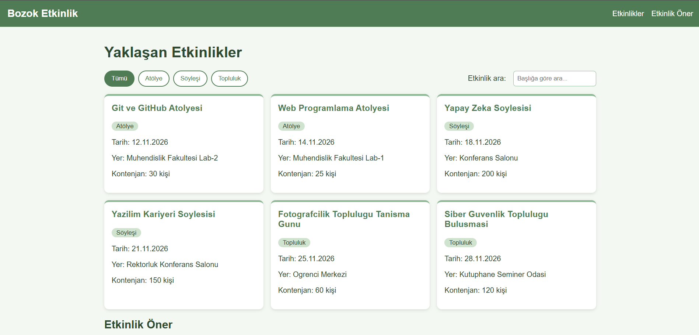

# Kampüs Etkinlik Panosu

Bu proje, BMH231 Web Programlama dersinin 2. ödevi için hazırladığım bir web uygulaması.

## Ne yapıyor?

Kampüsteki atölye, söyleşi ve topluluk etkinliklerini kartlar halinde listeliyor.
Sayfayı açınca etkinlikler kendi yazdığım Node.js sunucusundan `fetch` ile geliyor.

Sayfada yapabildiklerim:
- Etkinlikleri türe göre filtrelemek (Tümü / Atölye / Söyleşi / Topluluk)
- Başlığa göre arama yapmak (filtreyle birlikte de çalışıyor)
- "Etkinlik Öner" formuyla yeni etkinlik önermek (form kontrolleri JavaScript ile yapılıyor)

Etkinlikleri kendim seçtim. İlgilendiğim topluluklardan olan fotoğrafçılık ve siber güvenlik
etkinliklerini de listeye ekledim.

Ödevde istendiği için hiçbir kütüphane kullanmadım. Ön yüzü düz HTML, CSS ve JavaScript ile,
sunucuyu da sadece Node.js'in `http`, `fs` ve `path` modülleriyle yazdım.

## Nasıl çalıştırılır?

Bilgisayarda Node.js ve Git kurulu olması gerekiyor.

```
git clone https://github.com/Rumeysaaa730/bmh231-odev2.git
cd bmh231-odev2
npm start
```

Terminalde "Sunucu çalışıyor" yazısı çıkınca tarayıcıdan `http://localhost:3000` adresine gidebilirsiniz.

## API uç noktaları

| Yöntem | Yol | Durum kodu | Ne döndürüyor? |
|---|---|---|---|
| GET | `/api/etkinlikler` | 200 | Bütün etkinlikler (JSON) |
| GET | `/api/etkinlikler?tur=atolye` | 200 | Sadece o türdeki etkinlikler (`atolye`, `soylesi`, `topluluk`) |
| GET | `/api/etkinlikler/3` | 200 | id'si 3 olan etkinlik |
| GET | `/api/etkinlikler/999` | 404 | `{"hata": "Etkinlik bulunamadı"}` |
| GET | Başka bir yol | 404 | "Sayfa bulunamadı." (düz metin) |
| GET dışındaki yöntemler | Herhangi bir yol | 405 | Düz metin ve `Allow: GET` başlığı |

## Klasör yapısı

```
bmh231-odev2/
|-- sunucu.js          (sunucu)
|-- etkinlikler.json   (etkinlik verileri)
|-- package.json
|-- .gitignore
|-- README.md
`-- public/
    |-- index.html
    |-- stil.css
    `-- betik.js
```

## Ekran görüntüsü

